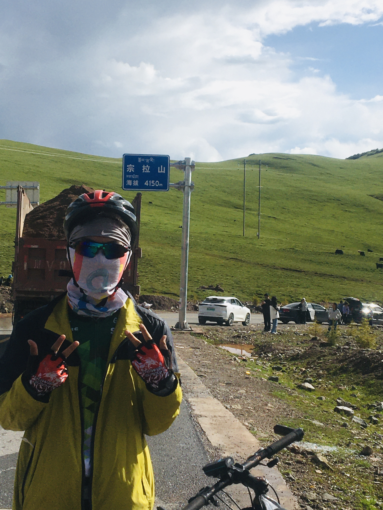

<table>
  <tr>
    <td valign="top">
      <h1>Gaoshan Zeng / 曾高山</h1>
      
<strong>AI for Science builder | First-principles simulation | Materials informatics | Open-source developer</strong>

      
I am an undergraduate student in <strong>Electronic Science and Technology</strong> at <strong>Sichuan Agricultural University</strong> with a <strong>4.22/5.0 GPA</strong>. My work sits at the intersection of <strong>AI4S, materials science, first-principles simulation, finite-element / electromagnetic simulation, chemical experiments, and AI agents</strong>.

      
I am especially interested in building systems that close the loop between <strong>domain knowledge, simulation, experiment, and autonomous discovery</strong>.

      

        
        
        
      

      
<strong>Research interests:</strong> AI4S, AI Scientist agents, ML potentials, materials informatics, DFT/MD, high-entropy materials, microwave absorption, electrochemical sensing, and high-throughput screening.

      
<strong>Public writing:</strong> WeChat public account <strong>飞鸟想要飞</strong>, with 500k+ total views.

    </td>
    <td width="250" align="center">
      
       
      Solo cycling at Zongla Mountain, 4,150 m
    </td>
  </tr>
</table>

---

## Project Experience

### AI4S and Scientific Computing

**DFR-related high-throughput screening research**  
*Department of Artificial Intelligence, Xiamen University, 2026.02*

- Worked on DFR-related research for accelerating high-throughput screening workflows.
- Focused on connecting AI models with candidate generation, simulation evaluation, and fast property filtering.
- Interested in turning high-throughput screening from a manual pipeline into a more automated and reproducible research loop.

**Electrodeposited Cu foils: microstructure and mechanical properties**  
*University of Science and Technology of China / Institute of Metal Research, Chinese Academy of Sciences*

- Worked around the system studied in *The effect of 2-mercaptobenzimidazole concentration on the microstructure and mechanical properties of electrodeposited Cu foils*.
- Studied how 2-mercaptobenzimidazole (MBI) affects electrodeposited Cu foils through grain refinement, surface morphology, crystallographic texture, nanotwinned grains, and thermal stability.
- Followed the electrochemical mechanism behind additive-assisted Cu electrodeposition, including MBI adsorption and complexation with cupric ions.

**Machine learning for high-entropy materials**  
*KAUST, visiting student / research assistant, 2025.09 - 2026.03*

- Built ML workflows for high-entropy alloys and oxides using ALIGNN, composition-based feature vectors, and JARVIS-DFT data.
- Focused on formation enthalpy, total energy, magnetic moments, and generalization under sparse high-fidelity data.
- Worked on accelerating candidate screening in large composition spaces.

**Electronic-structure atlas of MoS2 nanotubes with DeepH and first-principles workflows**  
*Westlake University, research assistant, 2025.07 - 2025.09*

- Integrated VASP, OpenMX, ABACUS, Quantum ESPRESSO, CHGNet, and DeepH into automated electronic-structure workflows.
- Studied chirality-dependent bandgaps, effective masses, and direct/indirect bandgap transitions.
- Compared DeepH predictions with DFT-level calculations to evaluate accuracy and computational efficiency.

**AI Scientist agents for materials discovery**  
*DeepModeling / AI4S exploration*

- Working on agentic workflows for literature understanding, hypothesis generation, simulation planning, and materials-design feedback loops.
- Interested in making scientific agents more reproducible, tool-aware, and grounded in physical constraints.

**LLM-guided reverse design of high-entropy microwave absorbers**  
*Manuscript in submission*

- Developing an autonomous LLM-agent-guided framework for multi-scale reverse design of high-entropy microwave absorption materials.
- Combining domain reasoning, conditional diffusion / reinforcement-learning style generation, ALIGNN-based stability evaluation, and CST-based electromagnetic simulation.
- Goal: accelerate the discovery of high-performance, ultra-broadband microwave absorbers with physics-aware constraints.

### Applied AI, Sensing, and Materials Projects

**Machine-learning-integrated electrochemical sensing for farmland heavy metals** 
*Provincial Undergraduate Innovation and Entrepreneurship Training Program, project lead, 2024.12 - 2025.09*

- Led the design of an electrochemical sensing and machine-learning integration platform for Pb2+ and Cd2+ detection.
- Built a PAC-SVR-LSTM pipeline with PCA and wavelet denoising for classification, concentration regression, and dynamic interference compensation.
- Achieved a 0.8 nM detection limit, 98.2% identification accuracy, and an R2 above 0.995 for concentration quantification; the project resulted in two software copyrights.

**Composite nanofiber and machine-learning heavy-metal sensing platform** 
*National Undergraduate Innovation and Entrepreneurship Training Program, core member, 2024.06 - 2025.09*

- Prepared composite nanofiber electrodes through electrospinning and optimized electrode structure for heavy-metal ion capture.
- Built Python pipelines with Scikit-learn and TensorFlow to compare supervised-learning models for multi-component heavy-metal recognition.
- Helped develop a low-cost, non-destructive prototype for meat and soil testing using electrochemical measurements and data-driven analysis.

**Tianxun Daoan: UAV and AI system for rice disease, gas, and pollution monitoring** 
*Challenge Cup project, project lead, 2025.01 - 2025.10*

- Combined visual detection, gas sensing, and route-planning strategies for early warning of rice disease and pollution events.
- Improved U-Net-style detection workflows for smoke and leakage-point recognition, then fused them with gas concentration measurements.
- Built a real-time monitoring workflow that streamed aerial inspection imagery and sensor signals back to a ground-control interface.

**Portable intelligent pesticide-residue detection system** 
*University research-interest training project, project lead, 2025.12 - 2026.03*

- Designed a frequency-domain cross-modal fusion module for combining sensing signals with lightweight visual models.
- Explored MobileViT-style architectures, residual learning, and classical machine-learning models for pesticide-residue recognition.

### Open-source Developer Tools

I also build small, focused tools for AI-native development workflows:

- [docs-drift-radar](https://github.com/zenggs05/docs-drift-radar): catch stale README snippets, CLI help, and OpenAPI docs in CI.
- [pr-evidence-pack](https://github.com/zenggs05/pr-evidence-pack): turn a PR diff into a reviewer-ready evidence pack.
- [browser-skill-forge](https://github.com/zenggs05/browser-skill-forge): record browser workflows and export Playwright / agent skills.
- [Auto_PaperFetcher](https://github.com/zenggs05/Auto_PaperFetcher): automate paper fetching and research-workflow collection.
- [vscode-remote-ssh-proxy-codex](https://github.com/zenggs05/vscode-remote-ssh-proxy-codex): improve remote SSH / proxy workflows for coding agents.

---

## Skills

**Programming and engineering**

**AI and data science**

- Graph neural networks, ALIGNN, ML potentials, diffusion models, reinforcement learning, LSTM/SVR pipelines
- Computer vision for sensing and inspection: U-Net style models, MobileViT-style lightweight models
- Scientific data pipelines: feature engineering, active learning, uncertainty/OOD sampling, benchmark evaluation

**Scientific computing and simulation**

- First-principles and electronic structure: VASP, CP2K, Quantum ESPRESSO, Materials Studio, OpenMX, ABACUS, DeepH
- Molecular dynamics and chemistry simulation: GROMACS, Gaussian, LAMMPS
- Multiphysics and electromagnetic simulation: COMSOL, CST Studio Suite
- Data analysis and research tooling: Origin, SPSS, Python scientific stack, Linux HPC workflows
- Chemical experiments: materials synthesis, annealing, combustion, hydrothermal preparation, electrochemical sensing, electrode-material preparation

These simulation and experimental skills let me contribute to many published materials papers through DFT modeling, RCS / electromagnetic simulation, COMSOL analysis, Python data processing, and mechanism interpretation.

---

## Selected Publications

1. **G. Zeng**, H. Huang, et al. *Machine-Learning and Atomic-Scale Mechanistic Insights for Designing Gradient Porous MOF-Derived Carbon Electrodes*. **Inorganic Chemistry**, 2025.  
   First-author work combining ML, DFT/MD, and interpretable design rules for MOF-derived carbon electrodes.

2. N. Wang, X. Kou, **G. Zeng**, et al. *Geometry-defect-spin coupling in chiral high-entropy systems: Multiscale mechanisms of GHz electromagnetic dissipation*. **Science Advances**, 2025.  
   Multiscale study of chiral high-entropy systems for broadband electromagnetic dissipation.

---

## Honors

- Meritorious Winner, The Mathematical Contest in Modeling
- Third Prize, Asia and Pacific Mathematical Contest in Modeling
- Academic Excellence Scholarship, Sichuan Agricultural University
- 20+ awards across national, provincial, and university-level competitions

---

## What I Am Building Toward

I want to keep working on systems that make scientific discovery more programmable:

- AI agents that can read papers, call tools, run simulations, and report evidence.
- ML potential and materials-informatics workflows that scale from small datasets to real discovery loops.
- Open-source developer tools that make research and engineering workflows easier to reproduce.

Outside research, I like long-distance cycling and endurance challenges. I once rode solo for 18 days from Chengdu to Lhasa, covering 2,300+ km across many high-altitude mountain passes. That experience shaped how I think about hard problems: break the route down, keep moving, and do not be afraid of difficult terrain.

For the September 2026 domestic postgraduate recommendation process in China, I hope to find a strong research group where I can keep pushing AI4S, scientific simulation, and autonomous materials discovery forward.

  
  

